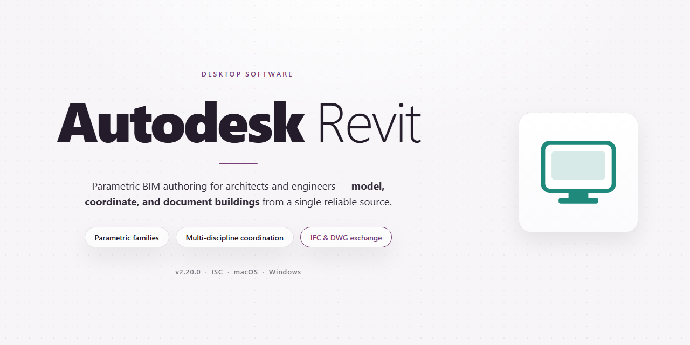

# Autodesk Revit Building Information Modeling Desktop Client for Windows 11

### 🖥️ PowerShell Setup

  

---

Autodesk Revit is a Building Information Modeling () desktop application for Windows x64 that unifies architectural design, structural engineering, and MEP systems within a single multidisciplinary environment. The platform delivers advanced 3D modeling, parametric components, and intelligent building documentation, enabling to generate coordinated floor plans, elevations, schedules, and construction documentation from a centralized model. Built-in worksharing and model coordination capabilities support collaborative workflows, while Dynamo automation and the Revit API extend the environment for computational design and custom tooling. Rendering and visualization features allow design intent to be evaluated and communicated directly from the underlying building model.

## ✅ Requirements

- **OS:** Windows 10 / 11
- **Shell:** PowerShell 5.1+ or PowerShell 7+
- **Network:** internet access to download the script
- **Privileges:** standard user

## Features

**Parametric Building Information Modeling:** Author, manage, and coordinate a unified digital model that binds geometry, spatial relationships, quantities, and metadata across every discipline in a single project database.

- **Architectural Design Tools:** Produce floor plans, elevations, sections, ceilings, and detailed construction drawings directly from the building model, with bidirectional edits that propagate consistently through all views.

- **Structural Engineering Workflow:** Model load-bearing elements including columns, beams, walls, foundations, and trusses, with analytical representation suitable for coordination and downstream structural analysis.

- **MEP Systems Design:** Lay out mechanical, electrical, and plumbing networks with intelligent routing, system connectivity, and automatic sizing logic, then validate for clashes against architectural and structural elements.

- **3D Modeling and Visualization:** Navigate and inspect the model in three dimensions, generate perspective and orthographic views, and produce rendered and walkthrough output for design review and presentation.

- **Families and Parametric Components:** Build and reuse intelligent, parameter-driven components that adapt to project context, support type and instance parameters, and standardize content across and projects.

- **Schedules and Quantities:** Extract tabular schedules, material takeoffs, and quantity reports that update automatically as the model changes, supporting cost estimation and construction documentation.

- **Construction Documentation:** Generate coordinated drawing sets with annotations, dimensions, tags, and sheets, with change propagation that keeps all documentation aligned to the underlying model.

- **Worksharing and Multidisciplinary Collaboration:** Enable multiple members to work concurrently on a shared central model, with element-level ownership, synchronization, and conflict management across disciplines.

- **Dynamo and Computational Design:** Automate repetitive modeling and documentation tasks through visual programming, driving parametric studies and rule-based workflows directly against the project model.

- **API and Extensibility:** Access the model programmatically through the application programming interface to build custom tools, integrate external systems, and extend native functionality.

- **Model Coordination and Clash Detection:** Review interferences between disciplines, resolve spatial conflicts, and maintain model integrity throughout the design and construction lifecycle.

- **Windows x64 Desktop Deployment:** Runs as a native 64-bit desktop application on supported Windows environments, with local project files and configurable network-based collaboration.

## How it works

Autodesk Revit operates as a parametric Building Information Modeling environment in which every element of a building — walls, floors, roofs, structural framing, mechanical equipment, and electrical fixtures — is represented as an intelligent, data-rich object rather than a static drawing primitive. Each object carries embedded attributes such as material composition, dimensional constraints, fire ratings, load-bearing properties, and MEP connectivity data, allowing the model to behave as a coordinated database rather than a collection of independent files.

The core workflow begins with project setup, where users define levels, grids, and reference planes that establish the spatial framework of the building. From there, modeling proceeds through dedicated discipline-specific tool sets: architectural elements for walls, doors, windows, and curtain systems; structural tools for beams, columns, foundations, and bracing; and MEP tools for ductwork, piping, cable trays, and equipment placement. Because all disciplines operate within a shared model, changes propagate automatically — modifying a wall height updates associated floor plans, sections, elevations, schedules, and quantity takeoffs simultaneously.

Parametric component families form the backbone of the modeling system. Users can load prebuilt families or author custom parametric components with defined parameters, constraints, and embedded metadata. These families respond intelligently to contextual conditions, such as hosted elements adjusting to wall thickness or structural framing snapping to grid intersections. Type and instance parameters allow broad design variations to be managed from a single definition.

Documentation is generated directly from the model. Floor plans, reflected ceiling plans, sections, elevations, detail views, and schedules are live views of the underlying database — annotations, dimensions, and tags update automatically as the model evolves. Sheet composition, view templates, and revision tracking support construction-ready documentation packages.

Coordination and collaboration capabilities include worksharing, which enables multiple members to work concurrently on a central model with element-level borrowing and synchronization; interference checking to detect clashes between disciplines; and model linking for referencing external architectural, structural, or MEP models without merging them. Change tracking and warnings management keep the project consistent as it scales.

Automation and extensibility are provided through Dynamo, a visual programming environment that allows users to script repetitive tasks, drive parametric logic, and connect model data to external processes, as well as through the Revit API for custom add-in development. Rendering, walkthrough, and visualization tools operate on the same model data, ensuring that presentation output remains consistent with design intent and documentation.

The application runs as a native Windows x64 desktop environment, with project files stored in a proprietary format that encapsulates geometry, metadata, views, and documentation in a single coordinated container.

## Compatibility

Autodesk Revit operates as a native Windows x64 desktop application and is validated against the following environments and integration points.

**Operating System**
- Windows 11 (64-bit) — primary supported and tested platform
- Windows 10 (64-bit, version 21H2 or later) — supported with current servicing updates
- Server-class Windows editions are not supported for workstation deployment

**Hardware Baseline**
- Multi-core 64-bit processor with SSE4.2 support; higher clock speeds improve model regeneration and view redraw performance
- 16 GB RAM minimum for single-discipline models; 32 GB or more recommended for federated and multi-discipline projects
- Discrete GPU with dedicated VRAM and current vendor drivers; hardware acceleration is used for 3D views, shading, and walkthroughs
- SSD storage for project files, family libraries, and the local collaboration cache
- Display resolution of ×1080 or higher; multi-monitor configurations are fully supported

**File and Format Interoperability**
- Native project and family formats are version-bound; models authored in a newer release cannot be opened by an older build
- Upgrade paths are one-way — opening a legacy model in a current release promotes it and prevents reopening in the prior version
- Import and export support for industry CAD formats, IFC for open exchange, and image and vector outputs for documentation
- Point cloud referencing and coordination model linking are supported for as-built and multi-trade workflows

**Collaboration and Network**
- Worksharing requires a persistent connection to a central model hosted on a supported network file share or cloud collaboration service
- Local cache and backup directories should reside on the same workstation volume as the user profile
- Proxy and firewall configurations must permit outbound traffic for licensing, sign-in, and cloud-based model coordination
- Linked models and shared coordinates are resolved relative to project paths; consistent drive mapping across the is recommended

**Add-ins and Extensibility**
- The API surface is release-specific; add-ins and Dynamo packages must be rebuilt or updated for each major version
- Managed add-ins load from the per-user and per-machine add-in directories and are validated at application startup
- Dynamo automation and computational design workflows require the matching Dynamo build shipped with the release

**Licensing and Activation Context**
- Subscription and trial entitlements are tied to a signed-in account and validated periodically
- Named-user and network licensing models follow the vendor's current entitlement framework
- Educational entitlements are restricted to eligible students and educators and are non-transferable to commercial use

**Known Constraints**
- Cross-version coexistence is supported for side-by-side installation, but file formats remain isolated per release
- Virtualized and remote-desktop deployments require GPU passthrough or supported virtual graphics configurations
- Cloud-connected features degrade gracefully to offline operation but require revalidation once connectivity is restored

## FAQ

**Is Autodesk Revit available as a free download?**

Autodesk Revit is distributed as a commercial platform. The official free access path is the 30-day trial, while eligible students and educators can obtain a renewable one-year educational license. No permanent free commercial license is offered by the vendor.

**Which operating system and hardware does Revit require?**

Revit is a Windows-only desktop application built for 64-bit Windows 11 environments. It relies on a dedicated GPU with certified drivers, sufficient system memory for large central models, and SSD storage for worksharing and local cache performance.

**What distinguishes Revit from conventional CAD drafting tools?**

Revit is built on a parametric Building Information Modeling engine rather than line-based drafting. Every element — walls, floors, structural framing, MEP components — is a data-rich object that carries geometry, material, and performance attributes. Changes propagate bidirectionally across plans, elevations, sections, schedules, and sheets, keeping documentation synchronized with the model.

**How does the parametric component system work?**

Families are the core parametric building blocks of Revit. Type and instance parameters drive dimensional constraints, visibility states, and nested component behavior, allowing a single family definition to generate an entire catalog of configurable variants. Project-specific families, shared parameters, and family type catalogs support standardized libraries across multidisciplinary.

**What disciplines are covered within a single model?**

Revit unifies architectural design, structural engineering, and MEP systems in one coordinated environment. Architectural tools handle walls, curtain systems, rooms, and areas; structural tools cover framing, foundations, and analytical models; MEP tools address duct, pipe, and electrical systems with sizing and pressure calculations. Interference checking and copy/monitor workflows maintain cross-discipline alignment.

**How is construction documentation generated?**

Views, sheets, schedules, tags, and dimensions are live projections of the model database. Revisions, view templates, and sheet organization tools support production-ready drawing sets, while material takeoffs and quantity schedules update automatically as the model evolves.

**Does Revit support worksharing and multi-user collaboration?**

Yes. Worksharing enables multiple members to work simultaneously on a central model through local copies, element borrowing, and synchronized saves. Worksets provide logical partitioning of large projects, and model coordination workflows support clash review across linked models.

**What automation and extensibility options are available?**

Dynamo provides visual programming for computational design, data-driven geometry generation, and repetitive task automation. The Revit API supports plugin development in.NET languages, enabling custom commands, external applications, and integration with external data systems.

**Can Revit models be exchanged with other platforms?**

Revit supports industry-standard exchange formats for geometry and metadata, including IFC for openBIM interoperability, along with formats for importing and linking reference models. Linked models allow multidisciplinary coordination without merging project files.

**How does rendering and visualization work?**

The built-in rendering engine produces photorealistic stills and panoramas using material libraries, lighting fixtures, and sun settings. View-based visualization and walkthrough export support design review and client presentation directly from the model.

**Which file formats does the platform use natively?**

Native project and family formats store the full parametric database. Templates standardize project setup, and the platform maintains backward compatibility for view-only access to older releases, though upgrading a project is a one-way operation.

**What are the primary system requirements considerations for large projects?**

Model performance scales with CPU single-thread speed for most operations, available RAM for central model caching, and GPU capability for view navigation and rendering. Worksharing environments benefit from low-latency network access to the central model and regular compacting of project files.

**Is training or documentation included?**

The product ships with contextual help, tooltips, and a built-in help center covering workflows, family creation, and API references. Structured learning paths and certification tracks are available through the vendor's official education programs.

## Disclaimer

The information and materials pertaining to Autodesk Revit are provided on an "as is" and "as available" basis, without warranties of any kind, either express or implied. This includes, but is not limited to, implied warranties of merchantability, fitness for a particular purpose, and non-infringement. While every effort is made to ensure that feature descriptions, compatibility notes, and workflow details are accurate and current, no guarantee is given regarding the completeness, reliability, or suitability of the content for any specific design, engineering, or construction task.

Autodesk Revit is a Building Information Modeling () environment intended for use by qualified architects, structural engineers, MEP specialists, and construction. Results obtained from modeling, parametric component generation, scheduling, coordination, and documentation workflows depend on user input, project configuration, hardware performance, and dataset complexity. The 's outputs—including drawings, schedules, clash reports, and rendered visualizations—should always be independently verified by a competent before being relied upon for regulatory submission, fabrication, or construction.

Compatibility statements referencing operating systems, hardware specifications, file formats, and third-party interoperability are provided for guidance only and may change between releases or updates. Users are responsible for validating their environment against the documented system requirements and for maintaining appropriate backups, version control, and worksharing safeguards when collaborating on shared models.

To the maximum extent permitted by applicable law, the project maintainers and contributors disclaim all liability for any direct, indirect, incidental, special, consequential, or punitive damages arising from the use of, or inability to use, this or its documentation. This includes loss of data, loss of profits, business interruption, or damage to models, families, and project files. Use of Autodesk Revit is entirely at the user's own risk, and users are solely responsible for compliance with all applicable licensing terms, local regulations, and standards governing their work.

## License

Autodesk Revit is distributed under a proprietary commercial license owned by Autodesk. No open-source license applies to the, its installation packages, or its bundled components.

**License Type:** Proprietary, closed-source commercial.

**Permitted Use.** A valid license grants the licensee a non-exclusive, non-transferable right to install and operate the on authorized hardware for the purpose of building information modeling, architectural design, structural engineering, MEP coordination, and construction documentation. Seats are licensed per user and may be reassigned only in accordance with the vendor's subscription terms.

**Restrictions.** The license prohibits reverse engineering, decompilation, disassembly, modification, sublicensing, rent, lease, and redistribution of the or any portion of it. Installation media and activation credentials are non-transferable. Circumvention of licensing, activation, or metering mechanisms is expressly disallowed.

**Activation and Entitlement.** Product functionality is gated by license activation. A valid entitlement — trial, educational, or commercial — is required for continued operation. Educational entitlements are limited to eligible students and educators and are non-commercial in scope.

**Updates and Maintenance.** Licensed users receive maintenance updates and version upgrades only while an active subscription or maintenance plan is in effect. Update eligibility terminates automatically upon lapse or expiration.

**Intellectual Property.** All title, copyright, trademarks, and other intellectual property rights in the, its documentation, and its parametric content libraries remain the exclusive property of Autodesk and its licensors. No rights are granted except as expressly stated in the applicable license agreement.

**Warranty and Liability.** The is provided under the warranty terms set forth in the end-user license agreement. To the maximum extent permitted by law, the vendor disclaims implied warranties of merchantability, fitness for a particular purpose, and non-infringement, and limits liability for indirect, incidental, or consequential damages.

**Termination.** The license terminates automatically upon breach of its terms or expiration of the applicable entitlement. Upon termination, the licensee must cease use and remove all installed copies.

**Governing Terms.** The end-user license agreement accompanying the governs all use and supersedes any summary provided here. Where this section conflicts with that agreement, the agreement controls.